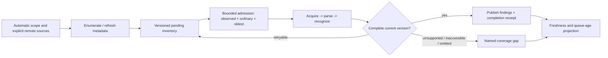
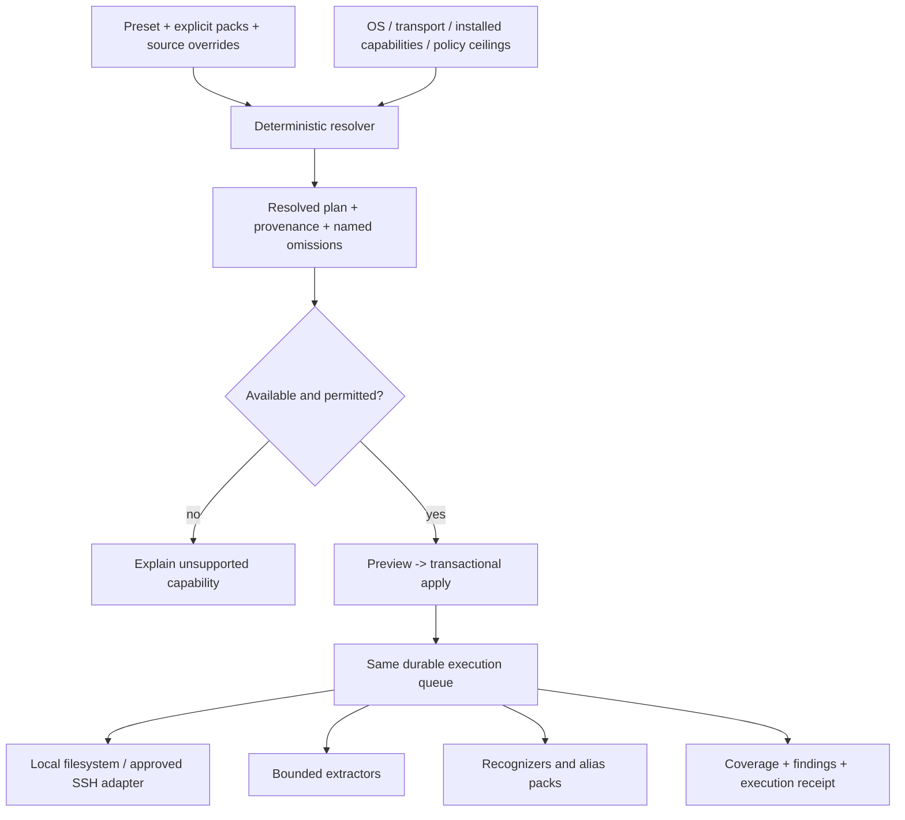
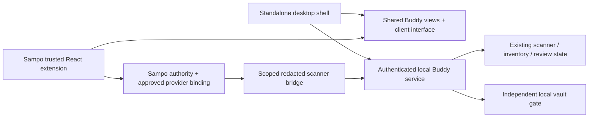

# Pilot follow-through: explicit finish lines

Planning baseline: published Mac pilot `0eabbc0`, with receipt on main at
`014c98c`. The pilot passed 399 installed tests / 143 subtests, 237 available
baseline content versions (39 synthetic), native profile preview/apply, upgrade
continuity and bounded automatic freshness controls. It did not complete its
backfill or establish a maximum oldest-content wait. These are separate claims.

This document is a plan, not evidence that the work below has shipped. The brand
assets and source wiring alongside this document are implemented; the published
pilot binary remains immutable. No new CI execution is needed for this plan.

## 1. Navigation, fairness and operational truth — first priority

| Piece | Change / existing surface | Exact checks and finish line |
| --- | --- | --- |
| Queue chronology | Extend encrypted inventory records in `packages/leakguard_vault/src/leakguard_vault/partitions.py` / `observations.py` with durable first-pending and last-complete times for a source generation/content version. Keep ordering clocks distinct from wall-clock display age. | Migration leaves old timestamps unknown, not guessed. Unchanged rediscovery cannot reset age; a new version gets a new pending observation. Lock/reopen and clock rollback preserve order. |
| Execution receipts | In `leakguard_host/discovery.py`, distinguish selected, acquired, inspected-complete, deferred and failed. Count completed ordinary/oldest work as well as observed-change work. | A selected-but-never-inspected item cannot satisfy fairness. Expired page budgets retain unexecuted work. Every named synthetic item either completes or has a truthful terminal gap. |
| Failure diagnostics | Record a bounded code, stage, exception class, retry count and runtime identity in scheduler/discovery error receipts. Omit exception messages, source contents, private paths and locals. | Inject acquisition, parser, detector, publication and shutdown failures separately. Verify stage/type attribution, redaction and recovery; preserve partial/incomplete coverage. |
| Saturation proof | Extend existing fairness tests and repeat the automatic-machine harness against a copied encrypted snapshot. Do not change selection to a fixture folder. | Deterministic sustained arrivals + old ordinary backlog, interrupted pages, lock/restart, rename/delete, partial parser result. Record first observed wait and actual completion for old content. A bounded live run must demonstrate at least one unchanged pre-existing pending version completing; it still does not prove global recall or a universal latency bound. |
| UI projection | Add aggregate age buckets, last successful content inspection, oldest completed wait and per-source gap counts to the existing host/Buddy projection. | Report unknown ages explicitly. Separate discovery progress from content inspection; do not show a single percentage when the denominator is still growing. |

The new-file control was ~75 seconds at one-minute recurrence in the pilot.
Repeat that same control/configuration while fixing fairness; compare both
freshness latency and oldest-work completion so one does not regress unnoticed.
Keep budgets finite. Do not invent a fleet-wide SLO from one Mac.



## 2. Daily workflow and UI — make the pilot easy to judge

| Piece | Concrete design | Finish line |
| --- | --- | --- |
| One configuration entry | Consolidate the legacy Active profile / worker controls in `App.tsx` with `ScanProfiles.tsx`. Retain one authoritative resolver and apply transaction. | Preset/custom-pack edits and lower-level settings cannot silently contradict one another. Existing per-source overrides remain visible and preserved. |
| Readable preview | Show changed fields, old -> new values, inherited origin and source overrides before optional advanced JSON. | Stale previews still reject; a failed preflight/apply restores prior config, schedules and persisted receipt. |
| Coverage overview | Separate “finding needs review”, “inspection pending” and “coverage gap”. Show source, last content inspection and next scheduled attempt. | Locked, paused, disconnected, interrupted and incomplete states are distinguishable by words, not just colors. |
| Finding detail | Group copies, show exact field/span where available, detector/rule and why it matched. Keep unknown/review distinct from confirmed credential classification. | Dismissing an alert does not stop inspection or mark a source clean. Review survives restart and version changes follow explicit policy. |
| Vault handoff | Make review -> deliberately save -> verify saved entry -> recheck source a visible sequence. Preserve both independent storage locks. | Test cancel, vault locked, duplicate entry, disk failure and source changed during review. Saving never claims the original copy was removed. |
| Fit and accessibility | Shared brand, tighter Settings grouping, keyboard focus, contrast, reduced motion, and a compact embedded layout. | Verify 1000px native minimum and 360/640px embedded containers, light/dark, keyboard-only navigation and screen-reader names. No motion required for status understanding. |

Suggested layout (labels, not new modes):

```text
Overview                         Settings
  Needs review                     Where: This Mac / configured VM locations
  Content inspection               What: preset + installed packs
    pending / completed / gaps     When: cadence + source overrides
  Last successful inspection       Budget: bytes / workers / slice time
  Sources and next attempts        Exceptions: exclusions / omissions / alerts
                                   Preview changes -> Apply
Finding -> Reason + copies -> Review -> Save to vault -> Recheck original
```

## 3. Recognition and protocol packs — evidence-led changes

| Piece | Concrete target | Checks |
| --- | --- | --- |
| Baseline maintenance | Keep label, rule, representation, source-version digest and availability status separate. Use synthetic structural reproductions in the repository; retain authorized real samples locally only. | Compare exact matching versions. Unavailable files are gaps, not new false negatives or successes. Include cold/warm equality and complete coverage. |
| JOSE / overlap | Address catalogue LG-A011: group overlapping observations for the same material while retaining each rule and recognizer attribution. | Two distinct secrets on one line stay distinct. Native line-only locations cannot be treated as exact columns. JSON fields, multiple copies and JOSE/native overlap get paired controls. |
| Encoded artifact review | LG-A008 / LG-A009 remain review classifications. Only add narrower schema interpretation where bounded evidence supports it. | Known container interior vs mixed text, literal siblings, malformed/truncated containers and embedded private-key/token controls. Do not suppress an entire binary/text file by extension or entropy. |
| Aliases and protocols | Preserve current bundled aliases and configurable team packs; add a new rule only for an observed unsupported representation or labelled miss. | Each addition needs a positive, close negative, boundary/length case, context variant, redaction check and cache-identity invalidation check. No new specific missing alias was established by the last replay. |

A changed filter must explain which baseline FP/FN it changes, preserve unaffected
findings, and report unresolved cases. Do not turn a reduction in total findings
into an unsupported precision claim.

## 4. Acquisition, parsing and caching — measure before replacing

| Piece | Implementation surface | Paired checks |
| --- | --- | --- |
| Cost attribution | Extend `tools/measure_pipeline_cost.py` for per-stage wall/CPU time, bytes, subprocess starts, parser invocations and cache-hit reasons. Keep redacted aggregate output. | Same fixture/config/runtime: cold, warm, same-size edit, rename, policy change, plugin change and interrupted/restarted run. Compare outputs before comparing speed. |
| Local execution | Use existing prepared runtime/session reuse; locate repeated parser startup or repeated reads before adding a new cache. | Warm unchanged work should demonstrably avoid eligible expensive stages. Changed content or changed recognition/parser closure must not reuse stale results. |
| Remote acquisition | Measure `ssh_directory_session.py` / remote discovery page trips, connection reuse, bytes transferred and retry work. Offline deterministic tests first; live VM checks require a current authorized connection window. | Disconnect mid-page, changed machine/root, unsupported session client, timeout and file replacement. Failed/unknown remote content never becomes a clean cache hit. |
| Parser limits | Keep per-file/format size, elapsed-time, output and supported memory budgets visible in resolved plans and coverage results. | Text/PDF/OOXML/MSG paired fixtures; encrypted/no-text, malformed, inflated output and cancellation cases retain explicit omissions/errors. |
| Additional caching | Consider extracted-text reuse only if the measured bottleneck warrants it; specify privacy, size/TTL, parser identity and invalidation first. | No raw-text cache silently introduced into persistent state. A result cache key covers content, extractor/detector/runtime/policy identity and source-generation rules. |

Stay with the current bounded coordinator and stores for this stage. There is no
measured evidence here requiring Dagster, a new graph framework, or a Rust/Go
rewrite. Revisit execution distribution only after stage-cost and queue evidence.

## 5. Presets, execution modes and omissions — independent dimensions

“Elision” needs three distinct controls: not acquiring content, deliberately
omitting an inspection surface, and suppressing a notification. They have
different effects on coverage and must not be one checkbox.

| Dimension | Current foundation | Next design / boundary |
| --- | --- | --- |
| Scope | Automatic local footprint and explicitly configured remote locations | Source IDs and navigation profiles stay separate from recognition presets. No remote host discovery is implied by selecting an alias pack. |
| Recognition | Standard / sensitive / inventory; versioned packs | Preserve detector/extractor extension points, pack provenance, required capabilities and organization ceilings. Inventory mode never implies content was inspected. |
| Cadence | Interval/daily polling and source overrides | Backfill and recurring reconciliation get separate visible budgets. Retain current hourly default until resource/freshness evidence supports a change. |
| Depth | Bounded supported text/document extraction | Future deep mode: explicit archive depth/member/expanded-byte/time limits, no recursive escalation by default. Requires a separately implemented parser capability. |
| Execution | Bounded polling/reconciliation | Future native write events are hints into the same durable queue; retain periodic reconciliation for event loss. Read/access auditing is a different, later OS capability. |
| Content exclusion | Explicit excluded scopes | Counts/reasons stay in the coverage view; preview expanded scope changes. |
| Inspection omission | Named unsupported/omitted surfaces | Preserve “not inspected” plus reason, selected policy and relevant limits. Never convert to a negative result. |
| Alert suppression | Review/dismissal and notification preferences | Suppress presentation/notification only; continue version tracking and content inspection. |

Resolve configuration before execution. The existing v1 validator rejects
unknown fields; proposed future knobs require a versioned schema/migration and
preview, not arbitrary additions to saved v1 JSON.



The next extension seam should be extracted around an actual second provider:
capabilities, version identity, bounded lifecycle and redacted diagnostics. Avoid
introducing a generic plugin system for every internal function.

## 6. Sampo embedding — reuse the product boundary, not the Electron shell

Reviewed local Sampo SDK source at `715a3fa8c02a82708a250a5c247796cb4013884b`:
`packages/sdk-react/README.md`, `packages/README.md`, hosted widget starter and
`ExtensionModule` / `HostServices` declarations. This is a checked local SDK
revision, not a claim about which revision any deployed Sampo host is running.
Before implementing, obtain a matching tested SDK artifact cohort from that host.

| Stage | Deliverable | Acceptance |
| --- | --- | --- |
| A. Shared presentation | Separate review/status/settings components from `App.tsx` shell, route, API and desktop globals. Introduce a narrow injected Buddy client and shell capabilities. | Standalone keeps its current behavior. Missing desktop capabilities render unavailable actions. Mount/unmount cancels requests and clears private in-memory detail. |
| B. Read-only Sampo app | Independent `apps/sampo-extension` package using the public `@sampo/contracts` / `@sampo/sdk-react` ABI, shared React peers, host appearance and optional environment services. First surfaces: coverage summary and redacted review inventory. | Build/pack outside the Sampo checkout; no private host imports or second React. Handle missing service, narrow containers, team/workspace change, revoked access and late response. |
| C. Backend bridge | An explicitly installed, approved provider maps allowed device/source IDs to redacted operations. Keep local scanner ownership and vault operations local initially. | Do not connect an arbitrary browser widget directly to the desktop loopback service or weaken its origin/auth boundary. No raw secrets or private paths enter shared layout state/context ports. Authorized source labels are metadata too. |
| D. Deliberate actions | Add only supported, approved commands after read-only qualification: request inspection, pause/resume and review annotation. Preserve request ID, source generation, policy digest and receipt. | Duplicate request is idempotent; unknown outcome is reconciled, not blindly retried. Current server-side authority is checked on every operation. Sampo selection is not authorization. |
| E. Vault actions | Later explicit local handoff, if required; not a prerequisite for an embedded status/review app. | Reveal/copy/export remain under independent vault unlock and deliberate local action. Never save secrets, reveal state, live handles or credentials in Sampo session JSON. |

The reviewed Sampo workflow contract currently describes `data.prepare.v1` work;
it does not automatically supply a scanner job protocol. Decide whether read-only
inspection summaries fit an approved prepared-data provider. Scanner commands need
a deliberate provider/operation contract, rather than disguising scans as a data
workflow. Do not weaken desktop CSP/origin controls to achieve embedding.



## Delivery order and closeout

1. Review/land brand assets and packaging wiring in a new revision; do not replace
   the published pilot's immutable ZIP or tag. Locally check icon formats, native
   template scaling and the in-app build. A future app release needs its own
   source/runtime identity and smoke receipt.
2. Land queue chronology + failure diagnostics, then the fairness proof and
   coverage projection. This is the most important reliability tranche.
3. Consolidate Settings and review/vault handoff; run the native synthetic
   workflow and migration checks against that exact build.
4. Run paired cost/baseline evaluations. Implement only evidenced dedup/filter or
   execution improvements, with before/after receipts and preserved negatives.
5. Extract shared UI/client while building Sampo's read-only adapter. Add remote
   command capabilities only after its binding/authority contract is decided.
6. Add event/deep/access providers individually when their concrete workflow is
   required; do not make the entire future plugin catalogue an alpha blocker.

For broader corporate distribution, signing/notarization or an approved managed
delivery route remains a separate operational dependency. Keep local qualification
and exact artifact checks; do not consume Actions minutes during this work.
