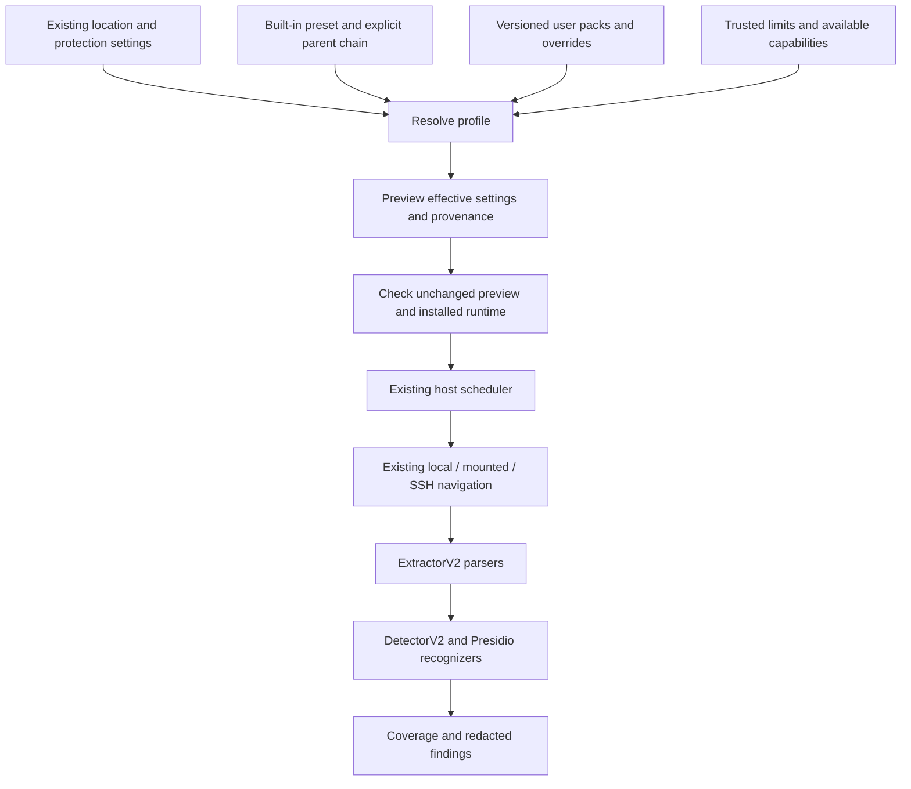

# Scan profiles and extension packs

A profile composes existing inspection components and host jobs. It does not
install software, grant access, discover remote machines, or create another
scheduler. Presets describe requested behavior; the resolver rejects unavailable
capabilities instead of silently approximating them.

## Public surfaces

| Surface | Implemented contract |
| --- | --- |
| Configuration | Version 1 JSON document: selected `preset`, explicit `presets`, explicit `packs`, optional `overrides` |
| Presets | `standard`, `sensitive`, `inventory`; user presets have stable IDs, integer revisions and one explicit parent |
| Inspection packs | Existing plugin modules/options, extractor routing, required formats, review-only rules and explicit omissions |
| Protocol specialization | Credential alias data; Presidio recognizer factories/options; existing `DetectorV2` for new grammars |
| Parsing specialization | Existing `ExtractorV2`, selected through `extractor_overrides` and checked by normal plugin preflight |
| Jobs | Recurring interval/daily reconciliation and inspect/inventory behavior through `HostService`; existing backfill/resume and source schedules are retained |
| Preview | Effective inspection/jobs, component names, option names, field provenance, identity, limitations; no option values or source bytes |
| Apply | Stale-preview rejection, runtime preflight, host stop/swap/resume, private overlay and rollback on synchronous failure |
| Interfaces | Python SDK, `leakguard-host scan-profile`, authenticated loopback API and Settings UI |

This is the configuration foundation, not native event monitoring or a new deep
scanner. `changes: events`, `deep: archives`, `access: audit`, and unknown
`requires` capabilities are rejected. They cannot be selected successfully just
because the configuration vocabulary recognizes them. Generic source-transport
and arbitrary executable-job plugins are not introduced here: local/mounted/SSH
remain existing source adapters; user jobs configure their scheduler contracts.

## Layer boundaries

Keep scope, inspection, cadence and exception policy independent. A broader
search must not silently turn on expensive extraction, and lowering alert
severity must not imply a file was inspected or excluded.



- **Scope:** existing sources, automatic machine coverage and explicit root
  exclusions. Profile application does not narrow the discovered footprint.
- **Inspection:** parsers, recognizers, aliases, required formats and byte limits.
- **Jobs:** existing backfill/resume plus interval or daily reconciliation. Native
  event-triggered work remains a separate future provider.
- **Exceptions:** explicit content omissions and review-only rules. Deprioritized
  work is still pending work; an omission is not a clean scan.

The current baseline is polling with the existing schedule (one hour on a fresh
profile), existing bounded per-file parsing, and no new recursive archive or
process-access layer. This feature does not introduce blanket cache/dependency
exclusions or a promise to detect obfuscated secrets in arbitrary encodings.

## Example

See [engineering.json](../examples/scan-profiles/engineering.json). It inherits
standard credential coverage, adds two exact aliases, and changes reconciliation
to five minutes. The interval is an example, not an inspection-latency guarantee.
Existing source-specific schedule overrides remain in force.

```sh
leakguard-host scan-profile catalog
leakguard-host scan-profile preview --document examples/scan-profiles/engineering.json --base-config /absolute/private/config.json
leakguard-host scan-profile check --document examples/scan-profiles/engineering.json --base-config /absolute/private/config.json
leakguard-host scan-profile export --document examples/scan-profiles/engineering.json --base-config /absolute/private/config.json --output-directory /absolute/new-private-directory
```

Preview never imports extension code. Check explicitly starts supervised runtime
preflight, but performs no content scan. Export creates a new private directory
with scanner configuration, host protection settings, the source document and
preview. Existing output directories are not replaced. These files can contain
private configuration, so they are created with owner-only permissions. Export
does not activate them or rewrite the supplied base configuration.

```python
from leakguard_host.scan_profiles import read_document, resolve, preflight
from leakguard_core.api import ScanConfig

plan = resolve(read_document("engineering.json"),
               base_config=existing_scanner_mapping,
               base_protection=existing_protection_mapping,
               ceilings={"max_file_bytes": 20_971_520, "scan_workers": 2})
print(plan.preview())
preflight(plan)  # explicit code-execution boundary
config = ScanConfig.from_mapping(plan.config)
# Construct the existing HostService with config and protection=plan.protection,
# using the application's existing unlocked encrypted scan store.
```

Apply both `plan.config` and `plan.protection` when constructing the host.
Inventory-only behavior and recurring schedules belong to the host; passing
only the scanner config to a direct `Scanner.scan()` call does not enforce them.

The trusted embedding application supplies ceilings. A pack cannot grant itself
larger limits. Buddy currently applies the core's validated limits; centralized
organization-policy distribution is not implemented by this feature.

## Resolution rules

1. Begin with the existing scanner and host settings. Scope, credentials, runtime
   executable paths, worker isolation policy and storage locations are retained.
2. Resolve the selected preset's parent chain (maximum eight nodes), then the
   selected preset, then explicit overrides. Unknown fields, duplicate IDs,
   missing parents and cycles are errors. Built-in IDs cannot be shadowed.
3. Compose the chosen built-in recognizers explicitly. Existing firm components
   are preserved; switching back to standard does not silently remove PII or
   custom recognizers previously added. Component removal remains an explicit
   existing plugin/configuration operation.
4. Apply referenced packs in declaration order. One pack may explicitly replace
   an option on an existing component while retaining its other options. Lists
   supplied as an option replace that option's list; they are not implicitly
   unioned. Two packs configuring the same module or extractor suffix conflict.
   Required-format and review-rule lists are additive. Named omissions explicitly
   replace an existing omission with the same ID; two selected packs declaring
   the same omission ID conflict. Reapplying a profile is idempotent. Unselected packs do not change runtime behavior.
5. Validate requested capabilities and trusted ceilings. The resulting scanner
   config still undergoes the existing supervised plugin and dependency checks.
6. Compute configuration identity. This identity is not a content-inspection or
   runtime-attestation claim: the scanner's existing runtime, policy and source
   fences remain authoritative, including plugin cache restrictions.

Custom plugin values belong in explicit pack options. Configuration is not a
credential vault. New code must be installed and trusted through the existing
extension workflow; supervision is not an OS security sandbox.

## Aliases without new code

Credential detector 0.1.0a4 accepts `aliases`, up to 128 `name:role` strings.
Roles are `password`, `api-key`, `client-secret`, `access-token`, `private-key`.
Aliases use existing exact key boundaries and ASCII case/separator normalization.
Collisions with built-in aliases or another configured alias are errors, including
redundant equivalent spellings. Configured aliases supplement the existing packs;
they do not change HTTP recognition, literal/reference filtering or severity.
Changing protocol grammar still requires a detector implementation and controls.

## Settings and API

Settings provides presets, custom JSON editing, Preview changes, and Apply
reviewed profile. It shows whether later settings edits diverged from the last
applied receipt. Preset application preserves automatic-machine scope choices,
explicit exclusions, source-specific schedules, the unlocked observation store,
and the independent credential-vault gate.

- `GET /api/scan-profiles`: built-in catalog and last applied document/status.
- `POST /api/scan-profiles/preview`: `{ "document": ... }`.
- `POST /api/scan-profiles/apply`: `{ "document": ..., "expected_identity": ... }`.

The normal loopback session, exact-origin and CSRF rules apply. A stale preview is
409; invalid or unsupported configuration is 400; unavailable runtime is 503.
Applying performs preflight before changing files. A synchronous host/config swap
failure restores prior settings and receipt. This uses the existing multi-file
settings persistence; it is not a new cross-file crash-atomic transaction system.
Corrupt persisted profile overlays fail closed at startup. Other settings changes
can make a saved receipt stale, which is displayed rather than hidden.

## Next interfaces, kept separate

Future source and change-feed providers must declare scope/identity, transport,
capabilities, bounded operations, cancellation and resume semantics. Future deep
extractors need shared expansion budgets and per-part provenance. Future access
monitors need explicit OS capabilities and audit/enforcement policies. Each must
pass conformance and report unavailable/partial coverage before it can advertise
a capability to this resolver. None is enabled by adding a preset name.

Qualification should cover malformed/conflicting plans, inactive definitions,
capability refusal, limits, option identity, preservation of custom components,
stale previews, failed apply rollback, restart persistence, real host scheduling,
custom alias positives/negative boundaries, and normal plugin conformance.


The opt-in `packages/leakguard_host/tests/test_scan_profiles_runtime.py` exercises
actual supervised workers with synthetic alias positives, reference/near-key
negatives and value-free output. Run against the matching installed wheels with
`LEAKGUARD_PROFILE_RUNTIME_CHECK=1` and `LEAKGUARD_GITLEAKS` set to the release's
absolute executable path. Ordinary source-only tests skip this check; that skip
is not runtime qualification.

## Local qualification — 2026-11-01

On macOS, the focused installed-wheel suite passed 162 tests plus 60 subtests,
including the opt-in real-worker alias check. The final TypeScript/Vite build
passed. Installed-wheel integration also exercised Buddy apply and restart
persistence with an explicit alias pack. Native browser computer use against a
separate synthetic Buddy profile verified custom JSON, resolved provenance,
five-minute UTC scheduling, apply, visible capability refusal, settings-drift
status, stale-preview rejection and successful re-preview/reapply.

The live application/profile were not changed. This qualifies the configuration
feature locally; it does not qualify native event monitoring, cross-platform
packaging, complete-machine recall, or a newly bundled distributable. The separate
whole-machine freshness qualification remains its own release check.
